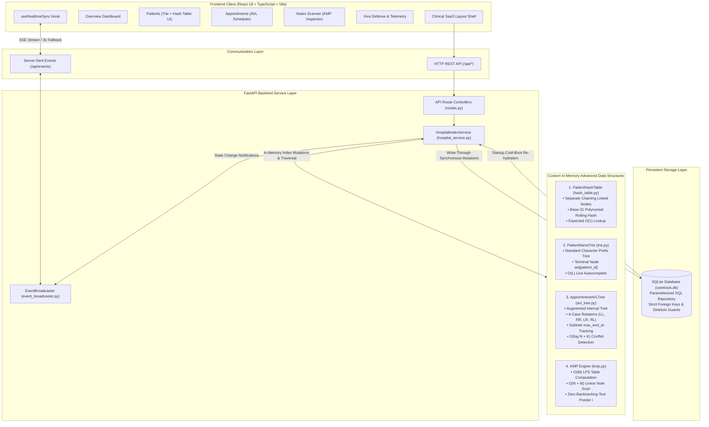

# The Hospital Patient & Appointment Tracker (CareTrack)
### Advanced Data Structures (ADS) Academic Capstone Prototype

> **Academic Course Evaluation Project — Synthetic Data Only. Not for Clinical Diagnosis or Treatment.**  
> *A production-quality Healthcare SaaS demonstrating pure, from-scratch implementations of four foundational Advanced Data Structures: Custom Hash Table (Separate Chaining), Standard Prefix Trie, Augmented AVL Interval Tree, and Knuth-Morris-Pratt (KMP) String Matcher.*

---

## Table of Contents
1. [Project Introduction](#1-project-introduction)
2. [Problem Statement](#2-problem-statement)
3. [Project Objectives](#3-project-objectives)
4. [Scope, Safety Disclaimers, and Limitations](#4-scope-safety-disclaimers-and-limitations)
5. [Key Features](#5-key-features)
6. [Technology Stack](#6-technology-stack)
7. [System Architecture Diagram](#7-system-architecture-diagram)
8. [Repository Folder Structure](#8-repository-folder-structure)
9. [Database Schema & Entity Relationships](#9-database-schema--entity-relationships)
10. [Detailed Description of the Four ADS Implementations](#10-detailed-description-of-the-four-ads-implementations)
11. [Justification for Each Data Structure](#11-justification-for-each-data-structure)
12. [Algorithm Explanations & Concise Pseudocode](#12-algorithm-explanations--concise-pseudocode)
13. [Time and Space Complexity Analysis Table](#13-time-and-space-complexity-analysis-table)
14. [Complete REST & SSE API Reference Table](#14-complete-rest--sse-api-reference-table)
15. [Step-by-Step Setup Instructions for Windows (PowerShell / CMD)](#15-step-by-step-setup-instructions-for-windows-powershell--cmd)
16. [Exact Commands to Run Backend and Frontend Locally](#16-exact-commands-to-run-backend-and-frontend-locally)
17. [How the Demo Dataset is Created and Reset](#17-how-the-demo-dataset-is-created-and-reset)
18. [How to Run the Automated Pytest Suite](#18-how-to-run-the-automated-pytest-suite)
19. [Known Limitations](#19-known-limitations)
20. [Future Enhancements](#20-future-enhancements)

---

## 1. Project Introduction
- **Academic Title:** The Hospital Patient & Appointment Tracker
- **Display Brand:** CareTrack
- **Curriculum:** Advanced Data Structures & Algorithms (ADS) Laboratory & Theory
- **Purpose:** To bridge theoretical data structures taught in college curricula with a high-fidelity clinical management workflow.

Unlike standard web applications that offload indexing entirely to SQL databases or rely on Python’s built-in dictionaries, CareTrack implements each data structure **from first principles in pure Python** (zero third-party tree libraries, zero built-in dictionary storage for hash buckets, and zero `in`/`re` regex shortcuts for string matching).

---

## 2. Problem Statement
Modern clinical outpatient scheduling suffers from three critical computational bottlenecks:
1. **Inefficient Patient Identification:** As clinical registries scale into tens of thousands of records, linear searches fail. Even database index scans incur disk I/O latency. Name searches must also handle duplicate patient names without data collision.
2. **Double-Booking & Scheduling Conflicts:** Overlapping appointments for the same doctor or same patient create clinical chaos. Standard binary search trees sorted only by start time cannot efficiently detect interval overlaps without $O(N)$ comparisons across long durations.
3. **Contraindication & Allergy Surveillance:** Doctors recording medical notes require rapid surveillance for critical allergy keywords (e.g., *"Penicillin"*, *"Latex"*, *"Sulfa"*). Naive string searching with pointer backtracking is computationally wasteful on extensive clinical narratives.

---

## 3. Project Objectives
1. Implement a **Custom Hash Table with Separate Chaining** to provide expected $O(1)$ patient record retrieval by primary `patient_id`.
2. Implement a **Standard Prefix Trie** to provide live $O(L)$ character-by-character autocomplete, with terminal node multi-ID sets to cleanly distinguish patients sharing identical full names.
3. Implement an **Augmented AVL Interval Tree** with compound ordering key `(start_at, appointment_id)` and subtree `max_end_at` tracking to detect scheduling conflicts in $O(\log N + K)$ time and maintain chronologically ordered schedules.
4. Implement the **Knuth-Morris-Pratt (KMP) Algorithm** to scan unstructured clinical notes and allergies in linear $O(N + M)$ time without text pointer backtracking.
5. Provide write-through atomic synchronization between an ACID **SQLite** database and all in-memory data structures, paired with real-time **Server-Sent Events (SSE)**.

---

## 4. Scope, Safety Disclaimers, and Limitations
> [!IMPORTANT]
> **Educational ADS Prototype — Synthetic Data Only:**
> All patient names, medical notes, allergies, and appointments in this repository are synthetic and fictional. This system is designed solely for academic viva defense, data structure benchmarking, and software engineering evaluation. It is **not certified as a Medical Device** and must **never be used for clinical diagnosis, prescription verification, or patient triage**.

---

## 5. Key Features
- **Executive Clinical Dashboard:** Live summary counters, today's schedule, recent registrations, and real-time **ADS Telemetry Dials** (load factor, bucket counts, Trie depth, AVL height).
- **Dual Patient Search System:** Live character-by-character Prefix Trie autocomplete vs. direct $O(1)$ Hash Table bucket ID lookup.
- **Conflict-Free AVL Appointment Scheduler:** Interactive chronological timeline with status actions (*Check In*, *Complete*, *Cancel*), and real-time interval conflict rejection on double-booking.
- **KMP Clinical Notes Scanner:** Batch pattern matching across clinical text with an interactive **LPS ($\pi$) Table Inspector** and mandatory clinician review warnings.
- **System Architecture & Viva Defense Portal:** Theoretical complexity matrices, examiner Q&A cheatsheets, and one-click demo data reset.
- **Real-Time Multi-Tab Synchronization:** Server-Sent Events (`GET /api/events`) with 3-second client polling fallback.

---

## 6. Technology Stack
- **Backend:** Python 3.12, FastAPI, Uvicorn (ASGI), Pydantic v2, Python standard library `sqlite3` (parameterized SQL, strictly ORM-free), `pytest`, `httpx`, `anyio`.
- **Frontend:** React 18, TypeScript 5, Vite, Vanilla CSS + Tailwind CSS utilities, Lucide React icons.
- **Real-Time:** HTML5 Server-Sent Events (`EventSource`) with automated polling fallback.
- **Persistence:** SQLite (`caretrack.db`), zero external database engine dependencies.

---

## 7. System Architecture Diagram



---

## 8. Repository Folder Structure

```
ads/
├── .gitignore                      # Git exclusion rules (__pycache__, venv, dist, *.db)
├── README.md                       # Comprehensive root documentation (this file)
├── backend/
│   ├── pytest.ini                  # Pytest configuration (pythonpath = ., testpaths = tests)
│   ├── requirements.txt            # Python dependencies (fastapi, uvicorn, pydantic, pytest, httpx)
│   ├── verify_live_api.py          # Automated live Uvicorn HTTP endpoint verification script
│   ├── data/
│   │   └── caretrack.db            # Default SQLite database file (created on startup)
│   ├── app/
│   │   ├── main.py                 # FastAPI application instance, CORS, lifespan startup hook
│   │   ├── api/
│   │   │   └── routes.py           # REST endpoints and SSE event streaming controller
│   │   ├── data_structures/        # PURE FROM-SCRATCH DATA STRUCTURE IMPLEMENTATIONS
│   │   │   ├── hash_table.py       # Separate Chaining Hash Table with custom HashNode
│   │   │   ├── trie.py             # Standard Prefix Trie with terminal ID sets
│   │   │   ├── avl_tree.py         # Augmented Self-Balancing AVL Interval Tree
│   │   │   └── kmp.py              # Knuth-Morris-Pratt string matching engine
│   │   ├── db/
│   │   │   ├── database.py         # Parameterized SQLite repository and transactional CRUD
│   │   │   └── seed.py             # Deterministic synthetic seed dataset
│   │   ├── models/
│   │   │   └── schemas.py          # Pydantic v2 schemas and ISO-8601 interval validators
│   │   └── services/
│   │       ├── hospital_service.py # Index Manager coordinating SQLite and in-memory structures
│   │       ├── event_broadcaster.py# Asyncio queue event broadcaster for SSE
│   │       └── exceptions.py       # Custom clinical domain exceptions
│   └── tests/                      # AUTOMATED PYTEST SUITE (53 TESTS)
│       ├── test_smoke.py           # Basic framework sanity tests
│       ├── test_database.py        # SQLite schema, CRUD, sequential IDs, and constraints
│       ├── test_hash_table.py      # Hash collisions, dynamic rehashing, deletion tests
│       ├── test_trie.py            # Autocomplete, normalization, duplicate names, node pruning
│       ├── test_avl_tree.py        # 4-case rotations, interval conflicts, simultaneous starts
│       ├── test_kmp.py             # LPS tables, linear text scans, safety notice tests
│       ├── test_service_sync.py    # Atomic write-through and server reboot simulation
│       ├── test_events.py          # SSE fanout, privacy compliance, full queue drops
│       └── test_api_integration.py # Full REST API integration with conflict validation
├── docs/                           # COMPREHENSIVE ACADEMIC VIVA & ARCHITECTURE DOCS
│   ├── ADS_JUSTIFICATION.md        # Syllabus alignment and comparison with naive approaches
│   ├── ARCHITECTURE.md             # Index management, startup re-hydration, SSE design
│   ├── TEST_PLAN.md                # Test execution matrix and edge case catalogue
│   ├── VIVA_PREPARATION.md         # 16 detailed examiner questions and model answers
│   └── DEMO_WALKTHROUGH.md         # Timed 5-to-7 minute live viva presentation script
└── frontend/
    ├── package.json                # React 18, TypeScript, Vite, Lucide React dependencies
    ├── tsconfig.json               # Strict TypeScript configuration
    ├── vite.config.ts              # Vite bundling configuration
    └── src/
        ├── App.tsx                 # Main application shell with tab state and modal triggers
        ├── index.css               # Clinical dark theme styling and Tailwind utilities
        ├── main.tsx                # React DOM root entrypoint
        ├── components/
        │   └── Layout.tsx          # App shell, sidebar, live connection badge, debounced Trie search
        ├── hooks/
        │   └── useRealtimeSync.ts  # SSE listener with automated 3-second polling fallback
        ├── pages/
        │   ├── DashboardPage.tsx   # Metric cards, schedule timeline, live ADS telemetry
        │   ├── PatientsPage.tsx    # Dual Trie + Hash Table lookup, directory table, profile drawer
        │   ├── AppointmentsPage.tsx# AVL interval scheduler, 409 conflict alert, status workflows
        │   ├── NotesScannerPage.tsx# KMP search engine, LPS table inspector, safety notice
        │   └── AboutSettingsPage.tsx# Architecture matrix, viva Q&A accordions, demo reset
        ├── services/
        │   └── api.ts              # Typed API client wrapping fetch with backend error parsing
        └── types/
            └── index.ts            # Strict TypeScript interfaces matching backend schemas
```

---

## 9. Database Schema & Entity Relationships

The underlying relational schema is defined in [database.py](file:///c:/Users/twipa/OneDrive/Desktop/ads/backend/app/db/database.py) using pure parameterized SQLite DDL:

```sql
CREATE TABLE IF NOT EXISTS doctors (
    doctor_id TEXT PRIMARY KEY,
    full_name TEXT NOT NULL,
    specialty TEXT NOT NULL,
    is_active INTEGER NOT NULL DEFAULT 1
);

CREATE TABLE IF NOT EXISTS patients (
    patient_id TEXT PRIMARY KEY,
    full_name TEXT NOT NULL,
    age INTEGER,
    phone TEXT,
    email TEXT,
    allergies TEXT NOT NULL DEFAULT '',
    medical_notes TEXT NOT NULL DEFAULT '',
    created_at TEXT NOT NULL,
    updated_at TEXT NOT NULL
);

CREATE TABLE IF NOT EXISTS appointments (
    appointment_id TEXT PRIMARY KEY,
    patient_id TEXT NOT NULL,
    doctor_id TEXT NOT NULL,
    start_at TEXT NOT NULL,
    end_at TEXT NOT NULL,
    duration_minutes INTEGER NOT NULL,
    reason TEXT NOT NULL,
    status TEXT NOT NULL DEFAULT 'Scheduled',
    created_at TEXT NOT NULL,
    updated_at TEXT NOT NULL,
    FOREIGN KEY(patient_id) REFERENCES patients(patient_id),
    FOREIGN KEY(doctor_id) REFERENCES doctors(doctor_id)
);
```

### Referential Integrity Rules:
1. **Foreign Key Enforcement:** `PRAGMA foreign_keys = ON;` is executed on every database connection.
2. **Patient Deletion Constraint:** Attempting to delete a patient record who has active appointments raises an `ActiveAppointmentsExistException`, rejected by the API with **HTTP 409 Conflict** to protect historical clinical records.
3. **Sequential Deterministic IDs:** IDs follow hospital standard numbering (`PT-1001`, `PT-1002`, `DOC-101`, `APT-2001`, `APT-2002`).

---

## 10. Detailed Description of the Four ADS Implementations

### 1. Custom Patient Hash Table (`backend/app/data_structures/hash_table.py`)
- **Node Structure (`HashNode`):** Contains `key: str` (`patient_id`), `value: Any` (`PatientResponse`), and `next: Optional[HashNode]` pointer.
- **Buckets:** Fixed-length Python list `self.buckets = [None] * capacity`.
- **Hash Function:** Base-31 polynomial rolling hash:
  $$h(s) = \left( \sum_{i=0}^{L-1} \text{ord}(s[i]) \times 31^{L-1-i} \right) \pmod{\text{capacity}}$$
- **Separate Chaining Collision Resolution:** If two patient IDs hash to the same bucket index, they are chained sequentially in a singly-linked list.
- **Dynamic Rehashing:** When the load factor $\alpha = \frac{\text{size}}{\text{capacity}} > 0.75$, the bucket array capacity doubles ($16 \to 32 \to 64$), and all nodes are re-hashed into the new buckets.

### 2. Standard Prefix Trie (`backend/app/data_structures/trie.py`)
- **Node Structure (`TrieNode`):** Contains `children: dict[str, TrieNode]`, `is_end_of_word: bool`, and `patient_ids: set[str]`.
- **Normalization:** Converts input strings to lowercase and collapses multiple spaces.
- **Multi-ID Terminal Sets:** If two patients are named *"Aarav Sharma"*, the terminal node at `... -> 'a'` stores `{"PT-1001", "PT-1002"}`.
- **Surname Token Indexing:** Multi-word names index both the full name (e.g., *"aarav sharma"*) and secondary tokens (e.g., *"sharma"*), allowing prefix queries on first or last names.
- **Post-Order Node Pruning:** Deleting a patient prunes characters from the tree that are no longer part of any other patient's name.

### 3. Augmented AVL Interval Tree (`backend/app/data_structures/avl_tree.py`)
- **Node Structure (`AVLNode`):** Contains compound key `(start_at, appointment_id)`, appointment attributes (`patient_id`, `doctor_id`, `end_at`, `status`), structural pointers (`left`, `right`), `height: int`, and augmented value `max_end_at: str`.
- **Compound Key Invariant:** Keys are ordered lexicographically by start timestamp first, and appointment ID second. This allows two appointments for different doctors to start at the exact same minute while preserving total ordering.
- **Subtree Augmentation:**
  $$\text{node.max\_end\_at} = \max(\text{node.end\_at}, \text{node.left.max\_end\_at}, \text{node.right.max\_end\_at})$$
- **Balance Factor & 4-Case Rotations:** Each node maintains balance factor $BF = \text{height(left)} - \text{height(right)}$. Rotations (LL, RR, LR, RL) restore balance if $|BF| > 1$.
- **Interval Overlap Conflict Query:** Given candidate interval $[S_{\text{new}}, E_{\text{new}})$, the tree searches for overlaps where:
  $$S_{\text{existing}} < E_{\text{new}} \quad \text{and} \quad E_{\text{existing}} > S_{\text{new}}$$
  If `node.left` exists and `node.left.max_end_at > S_new`, an overlap may reside in the left subtree; otherwise, search right.

### 4. Knuth-Morris-Pratt Pattern Matcher (`backend/app/data_structures/kmp.py`)
- **Failure Function (`compute_lps_table`):** Computes array $\pi$ of length $M$ where $\pi[j]$ is the length of the longest proper prefix of `pattern[0..j]` that is also a suffix of `pattern[0..j]`. Computed in $O(M)$ time.
- **Non-Backtracking Search (`kmp_search`):** Advances text pointer $i$ from $0$ to $N - 1$. On mismatch with pattern pointer $j$, resets $j = \pi[j - 1]$ without ever decrementing $i$. Operates in strict $O(N + M)$ time.
- **Clinical Text Scanner (`scan_clinical_text`):** Searches patient `allergies` and `medical_notes` fields, extracts character offset intervals $[start, end]$, builds surrounding contextual snippets, and attaches the mandatory clinical safety disclaimer.

---

## 11. Justification for Each Data Structure

| Data Structure | Syllabus Unit | Why It Was Chosen Over Alternatives |
| :--- | :--- | :--- |
| **Separate Chaining Hash Table** | Unit 2: Hashing | **Chosen over linear array scans and open addressing:** Linear scans take $O(N)$ time. Open addressing (linear/quadratic probing) suffers from primary clustering and tombstone deletion degradation. Separate Chaining provides clean $O(1)$ expected lookup and trivial deletion by unlinking nodes. |
| **Standard Prefix Trie** | Unit 5: Tries | **Chosen over SQL `LIKE 'prefix%'` and linear regex filtering:** SQL queries incur table scans or B-tree index traversal overhead on every keystroke. The Trie operates strictly in $O(L)$ time where $L$ is the character length of the query (typically 2–5 characters), completely independent of total registry size $N$. |
| **Augmented AVL Interval Tree** | Unit 3: Trees & AVL | **Chosen over standard BSTs and array range scans:** Standard BSTs sort only by a single scalar (start time) and can degenerate into $O(N)$ skewed chains. An unaugmented BST cannot prune interval overlap searches because an early-starting appointment might have a massive duration. Augmenting with `max_end_at` enables true $O(\log N + K)$ conflict detection. |
| **Knuth-Morris-Pratt (KMP)** | Unit 5: Pattern Matching | **Chosen over naive string search ($O(N \times M)$) and Python built-ins:** Naive search backtracks the text index $i$ on every mismatch, performing poorly on repetitive clinical terminology (e.g., *"Penicillin-resistant Penicillin-sensitive"*). KMP's precomputed $\pi$ table guarantees zero backtracking. |

---

## 12. Algorithm Explanations & Concise Pseudocode

### A. Base-31 Polynomial Rolling Hash
```python
def hash_key(key: str, capacity: int) -> int:
    hash_val = 0
    for char in key:
        hash_val = (hash_val * 31 + ord(char)) % capacity
    return hash_val
```

### B. Standard Trie Prefix Autocomplete
```python
def autocomplete(root: TrieNode, prefix: str) -> list[str]:
    curr = root
    for char in normalize(prefix):
        if char not in curr.children:
            return []
        curr = curr.children[char]
    
    # Subtree DFS to collect all terminal patient IDs
    results = set()
    def dfs(node):
        if node.is_end_of_word:
            results.update(node.patient_ids)
        for child in node.children.values():
            dfs(child)
    dfs(curr)
    return list(results)
```

### C. Augmented AVL Interval Overlap Search
```python
def find_conflicts(node: AVLNode, start_new: str, end_new: str, doctor_id: str, patient_id: str) -> list[AVLNode]:
    conflicts = []
    if node is None:
        return conflicts

    # If left subtree has an interval ending after our start, overlap could be in left
    if node.left and node.left.max_end_at > start_new:
        conflicts.extend(find_conflicts(node.left, start_new, end_new, doctor_id, patient_id))

    # Check current node interval overlap
    if node.start_at < end_new and node.end_at > start_new:
        if node.status != "Cancelled":
            if node.doctor_id == doctor_id or node.patient_id == patient_id:
                conflicts.append(node)

    # If new interval starts before current node end, right subtree might also overlap
    if start_new < node.max_end_at:
        conflicts.extend(find_conflicts(node.right, start_new, end_new, doctor_id, patient_id))

    return conflicts
```

### D. Knuth-Morris-Pratt (KMP) Failure Table & Search
```python
def compute_lps(pattern: str) -> list[int]:
    M = len(pattern)
    lps = [0] * M
    length = 0
    i = 1
    while i < M:
        if pattern[i] == pattern[length]:
            length += 1
            lps[i] = length
            i += 1
        elif length != 0:
            length = lps[length - 1]
        else:
            lps[i] = 0
            i += 1
    return lps

def kmp_search(text: str, pattern: str) -> list[int]:
    N, M = len(text), len(pattern)
    lps = compute_lps(pattern)
    matches = []
    i = 0  # text pointer (NEVER decrements)
    j = 0  # pattern pointer
    while i < N:
        if pattern[j] == text[i]:
            i += 1
            j += 1
        if j == M:
            matches.append(i - j)
            j = lps[j - 1]
        elif i < N and pattern[j] != text[i]:
            if j != 0:
                j = lps[j - 1]
            else:
                i += 1
    return matches
```

---

## 13. Time and Space Complexity Analysis Table

| Operation | Selected Structure | Average Time Complexity | Worst-Case Time Complexity | Space Complexity | Explanation |
| :--- | :--- | :---: | :---: | :---: | :--- |
| **Patient ID Lookup** | `PatientHashTable` | $O(1)$ | $O(N)$ | $O(N)$ | Expected $O(1)$ when $\alpha \le 0.75$. Degenerates to $O(N)$ only if all keys collide into one bucket. |
| **Patient Insert / Delete** | `PatientHashTable` | $O(1)$ | $O(N)$ | $O(N)$ | Amortized $O(1)$ insertion including dynamic table doubling and rehashing. |
| **Prefix Autocomplete** | `PatientNameTrie` | $O(L + K)$ | $O(L + S)$ | $O(\Sigma \cdot \text{chars})$ | $L$ is prefix length; $K$ is number of matches; $S$ is size of subtrie. Completely independent of registry size $N$. |
| **Trie Insert / Prune** | `PatientNameTrie` | $O(L)$ | $O(L)$ | $O(L)$ | Traverses character by character; prunes unused nodes on deletion. |
| **Appointment Insert** | `AppointmentAVLTree` | $O(\log N)$ | $O(\log N)$ | $O(N)$ | Self-balancing rotations maintain tree height $\le 1.44 \log_2 N$. |
| **Interval Conflict Check** | `AppointmentAVLTree` | $O(\log N + K)$ | $O(N)$ | $O(\log N)$ stack | Subtree `max_end_at` prunes disjoint branches; $K$ is number of overlapping conflicts. |
| **Chronological Schedule** | `AppointmentAVLTree` | $O(N)$ | $O(N)$ | $O(N)$ | In-order traversal visits nodes strictly in ascending key order. |
| **LPS Table Precomputation** | `kmp.py` | $O(M)$ | $O(M)$ | $O(M)$ | $M$ is pattern length. Computed once per keyword before search. |
| **Clinical Text Search** | `kmp.py` | $O(N + M)$ | $O(N + M)$ | $O(M)$ | $N$ is text length. Text pointer $i$ strictly increments; zero backtracking. |

---

## 14. Complete REST & SSE API Reference Table

| Method | Endpoint | Description | Request Body | Response Codes |
| :--- | :--- | :--- | :--- | :--- |
| `GET` | `/api/health` | System health check and ADS telemetry | None | `200 OK` |
| `GET` | `/api/dashboard/summary` | Live metrics, today's schedule, and telemetry | Query: `?date=YYYY-MM-DD` | `200 OK` |
| `POST` | `/api/system/reset-demo` | Resets SQLite to seed data and re-indexes all ADS | None | `200 OK` |
| `GET` | `/api/patients` | List all patients from Hash Table | None | `200 OK` |
| `GET` | `/api/patients/autocomplete` | Live prefix autocomplete via Standard Trie | Query: `?prefix=...&limit=10` | `200 OK` |
| `GET` | `/api/patients/{id}` | Direct $O(1)$ Hash Table patient record lookup | None | `200 OK`, `404 Not Found` |
| `POST` | `/api/patients` | Register new patient (indexes into Hash Table & Trie) | `PatientCreate` JSON | `201 Created`, `400 Bad Request` |
| `PUT` | `/api/patients/{id}` | Update patient details (re-indexes Hash Table & Trie) | `PatientUpdate` JSON | `200 OK`, `404 Not Found` |
| `DELETE`| `/api/patients/{id}` | Delete patient (with referential integrity guard) | None | `200 OK`, `404`, `409 Conflict` |
| `GET` | `/api/doctors` | List all available healthcare providers | None | `200 OK` |
| `GET` | `/api/appointments` | Chronological schedule from AVL in-order traversal | Query: `?date=...&doctor_id=...` | `200 OK` |
| `GET` | `/api/appointments/{id}` | Retrieve appointment by ID | None | `200 OK`, `404 Not Found` |
| `POST` | `/api/appointments` | Book appointment (with AVL interval conflict check) | `AppointmentCreate` JSON | `201 Created`, `409 Conflict` |
| `PUT` | `/api/appointments/{id}`| Reschedule appointment (with AVL conflict check) | `AppointmentUpdate` JSON | `200 OK`, `409 Conflict` |
| `PATCH`| `/api/appointments/{id}/status`| Update status (`Checked In`, `Completed`, `Cancelled`) | `AppointmentStatusPatch` JSON | `200 OK`, `404 Not Found` |
| `POST` | `/api/notes/search` | Search clinical notes via Knuth-Morris-Pratt | `NotesSearchRequest` JSON | `200 OK`, `422 Validation` |
| `GET` | `/api/events` | Server-Sent Events real-time change stream | None | `200 OK` (Event Stream) |

---

## 15. Step-by-Step Setup Instructions for Windows (PowerShell / CMD)

### Prerequisites
- Python 3.12+ installed and accessible via `python` or `py`.
- Node.js 18+ and `npm` installed.

### 1. Clone or Open Workspace
```powershell
cd c:\Users\twipa\OneDrive\Desktop\ads
```

### 2. Configure Backend Virtual Environment
```powershell
# Create virtual environment if not present
python -m venv .venv

# Activate in PowerShell
.\.venv\Scripts\Activate.ps1
# (Or in CMD: .\.venv\Scripts\activate.bat)

# Upgrade pip and install dependencies
python -m pip install --upgrade pip
pip install -r backend\requirements.txt
```

### 3. Install Frontend Dependencies
```powershell
cd frontend
npm install
cd ..
```

---

## 16. Exact Commands to Run Backend and Frontend Locally

### Terminal 1: Launch Backend (FastAPI + Uvicorn)
```powershell
cd c:\Users\twipa\OneDrive\Desktop\ads
.\.venv\Scripts\Activate.ps1
uvicorn app.main:app --app-dir backend --host 127.0.0.1 --port 8000 --reload
```
*Backend runs at:* `http://localhost:8000`  
*Interactive Swagger API Docs:* `http://localhost:8000/docs`

### Terminal 2: Launch Frontend (React + Vite)
```powershell
cd c:\Users\twipa\OneDrive\Desktop\ads\frontend
npm run dev
```
*Frontend runs at:* `http://localhost:5173`

---

## 17. How the Demo Dataset is Created and Reset
On cold boot, if `backend/data/caretrack.db` does not exist or has zero records, `app/db/seed.py` automatically initializes deterministic fictional seed data:
- **4 Healthcare Providers:** Dr. Aisha Khan (Cardiology), Dr. Marcus Vance (Orthopedics), Dr. Elena Rostova (Pediatrics), Dr. Samuel Chen (Dermatology).
- **9 Registered Patients:** Including **two patients sharing the identical name "Aarav Sharma"** (`PT-1001` age 28, and `PT-1002` age 54) to demonstrate Trie duplicate name resolution.
- **7 Today-Anchored Appointments:** Spanning `09:00` to `16:00` across doctors.
- **Searchable Notes & Allergies:** Containing terms such as *"Penicillin"*, *"Latex"*, *"Sulfa"*, *"Shortness of breath"*, and *"Asthma"*.

### One-Click Demo Reset:
Click the **"Reset Demo Dataset"** button on the Overview Dashboard, Patients page, or Architecture page, OR execute:
```powershell
curl -X POST http://localhost:8000/api/system/reset-demo
```
This resets SQLite to initial deterministic seed data, purges and reconstructs all in-memory structures, and broadcasts a `system_reset` SSE event across all browser tabs.

---

## 18. How to Run the Automated Pytest Suite

Execute the test suite from the `backend/` directory:
```powershell
cd c:\Users\twipa\OneDrive\Desktop\ads\backend
..\.venv\Scripts\python.exe -m pytest -v
```

### Test Suite Execution Output:
```
tests/test_smoke.py::test_smoke PASSED
tests/test_smoke.py::test_health_endpoints PASSED
tests/test_database.py (7 tests PASSED)
tests/test_hash_table.py (7 tests PASSED)
tests/test_trie.py (6 tests PASSED)
tests/test_avl_tree.py (7 tests PASSED)
tests/test_kmp.py (6 tests PASSED)
tests/test_service_sync.py (5 tests PASSED)
tests/test_events.py (3 tests PASSED)
tests/test_api_integration.py (10 tests PASSED)
======================= 53 passed, 1 warning in 18.48s =======================
```

To run the automated live server verification script:
```powershell
cd c:\Users\twipa\OneDrive\Desktop\ads\backend
..\.venv\Scripts\python.exe verify_live_api.py
```

---

## 19. Known Limitations
1. **Single-Node In-Memory State:** In-memory indexes reside within the Python process memory space. In a multi-worker production cluster (e.g. Gunicorn with multiple worker processes), in-memory state would require a distributed memory fabric (e.g. Redis) or sticky sessions.
2. **Fixed Duration Quantization:** Appointments default to standard intervals (15, 30, 45, 60 minutes) rather than arbitrary millisecond precision.
3. **Synthetic Clinical Scope:** The KMP engine matches exact normalized string patterns; it does not perform clinical natural language processing (NLP) or semantic symptom parsing.

---

## 20. Future Enhancements
1. **Multi-Field KMP Aho-Corasick Multi-Pattern Tree:** Upgrading to an Aho-Corasick automaton to scan entire pharmacological dictionaries in a single pass.
2. **2D Orthogonal Range Trees:** Augmented spatial range trees to schedule across physical operating theatres and clinical equipment simultaneously.
3. **B-Tree Disk Pagination:** Extending the in-memory AVL interval logic to an on-disk $B^+$-Tree for multi-gigabyte archival datasets.
