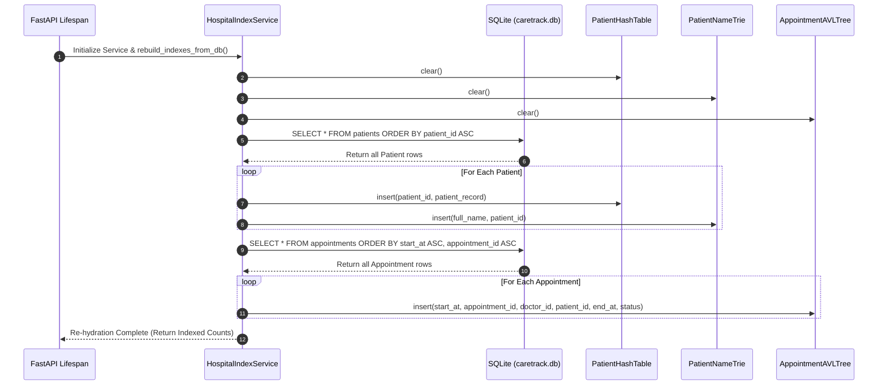
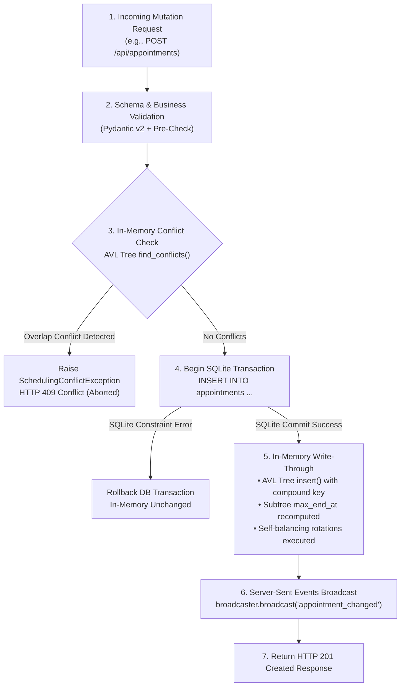

# System Architecture & Synchronization Specification
### CareTrack — The Hospital Patient & Appointment Tracker

> **Core Architectural Principle:** Write-Through Atomic Synchronization between ACID SQLite and Pure In-Memory Advanced Data Structures.

---

## 1. Architectural Philosophy & Layered Decomposition

CareTrack uses a dual-engine architecture designed for clinical speed and rock-solid persistence:
- **Persistent Storage Layer (SQLite):** Acts as the durable, transactional backing store ensuring that patient health information and historical appointments are never lost across power failures or process restarts.
- **In-Memory Computational Layer (ADS):** Houses custom in-memory data structures (`PatientHashTable`, `PatientNameTrie`, `AppointmentAVLTree`, and the `KMP` engine) to serve low-latency queries ($O(1)$ lookups, $O(L)$ autocomplete, and $O(\log N + K)$ conflict checks) entirely in RAM.
- **Service Orchestrator (`HospitalIndexService`):** Enforces write-through synchronization, ensuring that memory structures and SQLite are strictly coherent at all times.

---

## 2. Startup & Cold-Boot Index Reconstruction Sequence

When the FastAPI server boots up (triggered by the `lifespan` context manager in [backend/app/main.py](file:///c:/Users/twipa/OneDrive/Desktop/ads/backend/app/main.py)), `HospitalIndexService.rebuild_indexes_from_db()` executes an automated 4-step re-hydration:



### Cold-Boot Integrity Guarantees:
1. **Idempotence:** `rebuild_indexes_from_db()` clears all memory buckets and root pointers first. Re-running it at runtime (e.g. during a demo dataset reset) leaves zero ghost nodes or stale references.
2. **Sequential Consistency:** Patients are indexed first into the Hash Table and Trie so that appointments can cross-reference patient names during in-memory traversal.
3. **Compound Key Re-construction:** Appointments insert in chronological order, automatically balancing the AVL tree and computing augmented `max_end_at` subtree bounds from root to leaf.

---

## 3. Write-Through Atomic Synchronization Order

Every mutating operation (Create, Update, Reschedule, Cancel, Delete) follows a strict **Commit-to-DB-First** protocol before updating memory. This prevents memory leaks if SQLite aborts on a disk write or constraint violation:



### Detailed Operation Protocols:

#### 1. Patient Registration (`POST /api/patients`)
- **Step 1:** Generate sequential ID (`PT-XXXX`) from SQLite transaction.
- **Step 2:** `INSERT INTO patients` in SQLite with parameterized SQL.
- **Step 3:** Insert into `PatientHashTable` bucket linked list; rehash if $\alpha > 0.75$.
- **Step 4:** Insert into `PatientNameTrie` character tree, indexing both full name and surname tokens.
- **Step 5:** Broadcast `{"type": "patient_changed", "entity_id": "PT-XXXX", "action": "create"}` via SSE.

#### 2. Patient Deletion (`DELETE /api/patients/{patient_id}`)
- **Step 1:** Referential Safety Check: query SQLite for active appointments with `patient_id`.
  - If active appointments exist: raise `ActiveAppointmentsExistException` $\to$ return **HTTP 409 Conflict**.
- **Step 2:** Delete row from SQLite table `patients`.
- **Step 3:** Unlink node from `PatientHashTable` bucket linked list in $O(1)$ expected time.
- **Step 4:** Recursively prune characters from `PatientNameTrie` that no longer lead to any other patient ID.
- **Step 5:** Broadcast `{"type": "patient_changed", "entity_id": patient_id, "action": "delete"}` via SSE.

#### 3. Appointment Booking (`POST /api/appointments`)
- **Step 1:** Derive `end_at = start_at + duration_minutes`.
- **Step 2:** Execute `AppointmentAVLTree.find_conflicts(start_at, end_at, doctor_id, patient_id)` in $O(\log N + K)$ time.
  - If conflicting active intervals found: raise `SchedulingConflictException` with exact overlapping IDs and timeslot $\to$ return **HTTP 409 Conflict**.
- **Step 3:** Generate sequential ID (`APT-XXXX`) and `INSERT INTO appointments` in SQLite.
- **Step 4:** Insert into `AppointmentAVLTree`, updating subtree `max_end_at` and executing AVL rotations if $|BF| > 1$.
- **Step 5:** Broadcast `{"type": "appointment_changed", "entity_id": "APT-XXXX", "action": "create"}` via SSE.

#### 4. Appointment Status Transition (`PATCH /api/appointments/{id}/status`)
- **Step 1:** Verify appointment exists in `AppointmentAVLTree`.
- **Step 2:** `UPDATE appointments SET status = ?` in SQLite.
- **Step 3:** Update status in `AVLNode`. If transitioning to `Cancelled`, the interval is immediately ignored during future `find_conflicts()` searches, freeing the timeslot in $O(1)$ without needing tree deletion.
- **Step 4:** Broadcast `{"type": "appointment_changed", "entity_id": id, "action": "status_update"}` via SSE.

---

## 4. Server-Sent Events (SSE) Real-Time Architecture

The real-time engine resides in [backend/app/services/event_broadcaster.py](file:///c:/Users/twipa/OneDrive/Desktop/ads/backend/app/services/event_broadcaster.py) and connects to `GET /api/events`.

### 4.1 Strict Privacy Compliance (Zero PHI in Broadcasts)
Under HIPAA and healthcare privacy principles, broadcasting full patient clinical records across shared network channels is dangerous. CareTrack enforces a strict payload schema:

```json
{
  "type": "appointment_changed",
  "entity_id": "APT-2001",
  "action": "create",
  "timestamp": "2026-10-25T17:15:00.123456"
}
```
> **Privacy Guarantee:** Event payloads contain **zero patient names, phone numbers, email addresses, allergies, or clinical medical notes**. When the frontend receives this event, it uses the notification purely as a trigger to refresh active views via authenticated typed REST endpoints.

### 4.2 Multi-Subscriber Fanout & Queue Bounding
- Each connected client receives a bounded `asyncio.Queue(maxsize=100)`.
- If a slow client stalls, events are dropped via `put_nowait()` with an exception catch, preventing server memory starvation.
- Disconnected clients are cleanly pruned in a `finally` block during generator termination.

### 4.3 Keepalive Heartbeats
Every 15 seconds, the broadcaster yields an SSE comment `: heartbeat\n\n`. This prevents intermediary corporate firewalls, mobile carrier gateways, and reverse proxies from dropping idle HTTP connections.

### 4.4 Frontend Fallback Mechanism
The React hook [useRealtimeSync.ts](file:///c:/Users/twipa/OneDrive/Desktop/ads/frontend/src/hooks/useRealtimeSync.ts) connects via HTML5 `EventSource`.
- If the browser supports SSE and the backend is live: badge displays **"Live SSE Connected"** (emerald).
- If the connection drops or the browser environment restricts streaming: the hook automatically activates a clean **3-second polling interval** against `GET /api/health` and displays **"Polling Sync (3s)"** (amber).
- If the backend is completely offline: badge displays **"Offline"** (rose).
